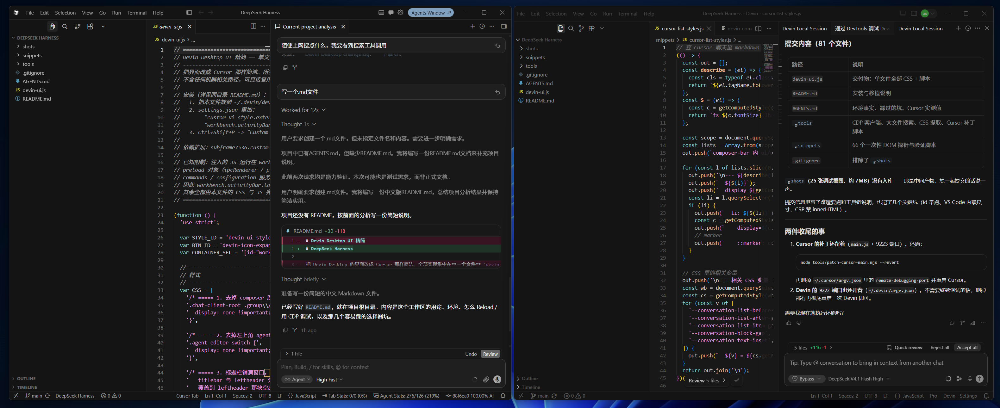

# devin-cursor-theme

把 Devin Desktop 的界面改造成 Cursor 的样子。



> 图左与图中是改造后的 Devin Desktop，图右是 Cursor 作对照。

这不是独立应用，交付物是注入进 Devin workbench 的 CSS / JS。
全部样式与行为集中在单文件 `devin-ui.js`，不含任何机器相关路径，可直接复制给别人用。

## 改了什么

**界面外壳**

- 菜单栏直接居左（原生布局里标题栏被挤在侧边栏右侧）
- 活动栏从左侧竖排移到顶部横排，默认只显示 4 个图标，其余点击箭头展开
- 去掉左上角的 agent/editor 切换区
- 去掉菜单、列表项、消息标签页上的蓝色描边
- 去掉空消息状态下的背景纹理
- 去掉侧边栏的 "Explorer" 标题栏

**空窗口欢迎页**

- 显示「最近打开的项目」列表（名称 + 路径），点一行就直接打开该项目
- 右侧 `View all` 打开可搜索的「打开最近的项目」选择器
- 默认视图是 Recent projects 而不是 Recent sessions（只种一次，之后手动切回 Sessions 不会被改回去）
- 上方保留 Open project / Clone repository / Connect via SSH 三张卡片

**聊天区**（数值全部取自 Cursor 的计算样式，不是目测）

- 输入框：圆角 12px、`padding 8px 10px 6px`、控制行按钮高 20px、按钮内图标 16px
- 变更条与输入框拼成一个描边盒子，变更条左右各内缩 9px、只圆上角
- 提问卡片（Agent 问你问题时那个卡片）也给一层不透明底，不再让消息列表透出来
- 思考区用 `opacity: 0.5` 暗化（暗化来自 opacity，不是文字色）
- 用户气泡、工具卡片、diff 行、行内代码、列表、表格
- 去掉「Your included … usage quota is exhausted.」用量耗尽红色横幅

## 环境

| 项 | 值 |
|---|---|
| 应用 | Devin 1.126.0 / Windsurf 3.10.31（Electron 42，Chrome 148） |
| 注入扩展 | `subframe7536.custom-ui-style` |
| 交付物 | `devin-ui.js` |

## 安装

1. 在 Devin Desktop 里安装扩展 `subframe7536.custom-ui-style`
2. 把 `devin-ui.js` 放到 `~/.devin/`
3. 用户 `settings.json` 加两行：

```json
"workbench.activityBar.location": "top",
"custom-ui-style.external.imports": ["file://${userHome}/.devin/devin-ui.js"]
```

4. 命令面板执行 `Custom UI Style: Reload`

`${userHome}` 是扩展支持的变量，Windows / macOS / Linux 通用。

> 注意：`custom-ui-style.watch` 的说明是 *"Automatically reload window on configuration
> changes (ignores imports)"* —— 改动 `external.imports` **不会**自动生效，必须手动 Reload。
> **改 `devin-ui.js` 文件内容同样要手动 Reload**：扩展是把 import 的内容烘焙进应用目录下的
> `out/vs/code/electron-browser/workbench/external.module.js`，只在激活时和 Reload 命令里
> 重新 patch（实测：多次重载窗口后该文件 mtime 不变）。

## 建议：关掉 Devin 自动更新

主题依赖 `custom-ui-style` 扩展对 `workbench.desktop.main.css` 和 `product.json` 的 patch，
应用升级会覆盖这些文件、让主题失效。建议关掉自动更新：

```bash
node tools/disable-updates.mjs          # 写入 "update.mode": "none"
node tools/disable-updates.mjs --revert # 还原
```

脚本自动定位各平台的用户 `settings.json`（macOS / Windows / Linux），做文本级编辑、保留原有注释，
改完**重启 Devin Desktop** 生效。也可以手动加 `"update.mode": "none"` ——
该键是 machine 作用域，只能写在用户 settings.json，工作区设置无效。

## 目录

```
devin-ui.js         交付物：全部 CSS + 脚本
docs/               展示截图
AGENTS.md           开发笔记：环境事实、选择器坑、Cursor 实测值、需求状态
tools/              调试工具链
snippets/           一次性 DOM 探针与验证脚本
shots/              调试过程截图（未入库）
```

## 调试工具链

界面本身是 workbench 主文档，不是 webview，所以可以用 CDP 直接调试。
Devin 的 `argv.json` 白名单里**本来就有** `remote-debugging-port`（不像 Cursor 需要打补丁），
用现成脚本开启即可：

```bash
node tools/enable-cdp.mjs      # 往 ~/.devin/argv.json 写 "remote-debugging-port": "9222"
node tools/restart-devin.mjs   # 重启 Devin 并等端口就绪
node tools/cdp.mjs list        # 列出 target
node tools/cdp.mjs evalfile workbench.html snippets/parts.js
node tools/cdp.mjs shot workbench.html out.png
node tools/enable-cdp.mjs --revert   # 调试完关掉端口
```

`restart-devin.mjs` 的 worker 用 `spawn(detached)`（即 `setsid`）脱离进程树 ——
因为 agent 自己就跑在 Devin 里，普通重启会把重启动作本身一起杀掉，端口永远等不到。

改完 `devin-ui.js` 后要让它生效，正式路径是命令面板的 `Custom UI Style: Reload`。
调试时想省掉这一步，可以把源文件烘焙进扩展的生成文件再硬重载：

```bash
{ printf '// %s\n' "$HOME/.devin/devin-ui.js"; cat "$HOME/.devin/devin-ui.js"; } \
  > "/Applications/Devin.app/Contents/Resources/app/out/vs/code/electron-browser/workbench/external.module.js"
node tools/cdp.mjs reload "Devin"   # Page.reload({ignoreCache:true})
```

> 必须用 `reload`（`ignoreCache`）而不是 `location.reload()` ——
> 渲染进程会缓存 `external.module.js`，普通重载拿到的还是旧脚本。

| 工具 | 用途 |
|---|---|
| `tools/cdp.mjs` | 零依赖 CDP 客户端（基于 node 原生 WebSocket） |
| `tools/enable-cdp.mjs` | 开启 / 关闭 CDP 调试端口（写 `~/.devin/argv.json`） |
| `tools/restart-devin.mjs` | 重启 Devin 并等端口就绪（不会被自己重启掉） |
| `tools/big-grep.mjs` | 大文件正则搜索（绕过常规 grep 的 4MB 限制） |
| `tools/extract-css.mjs` | 从 CSS 提取类名 / 变量定义 / 规则块 |
| `tools/list-settings.mjs` | 列出扩展 `package.json` 的所有配置项 |
| `tools/read-storage.mjs` | 用 `node:sqlite` 读 VS Code 的 `state.vscdb` |
| `tools/disable-updates.mjs` | 关闭 / 还原 Devin 自动更新（防止升级覆盖被 patch 的 CSS） |
| `tools/patch-cursor-main.mjs` | 给 Cursor 主进程打补丁以开启 CDP 端口（用于对照它的样式） |

## 几个容易踩的坑

- **id 里带点**。应用大量使用 `windsurf.cascadePanel`、`workbench.parts.titlebar` 这类
  **字面量 id**，所以 `#windsurf`、`.cascadePanel` 都选不中，必须写 `[id="..."]`。
- **CSS 必须 `!important`**。`external.css` 在 `workbench.desktop.main.css` **之前**加载。
- **Tailwind 的具名 group** 是 `group/beard-band`，CSS 里要转义成 `.group\/beard-band`。
- **CSP 禁 `innerHTML`**。workbench 的 CSP 含 `require-trusted-types-for 'script'`，
  注入的 JS 里给 `innerHTML` 赋值会抛 `TrustedHTML` 错误，必须用 `createElement` 构建 DOM。
- **VS Code 用 JS 写内联尺寸**。隐藏一个元素后，父容器的高度不会自动重算，
  要**逐层**把尺寸补回来（侧边栏 → `.content` → 面板，三层各有各的内联尺寸）。
- **调试结束后**用 `node tools/enable-cdp.mjs --revert` 关掉端口 —— 该端口对本机所有进程开放。

更多细节见 [AGENTS.md](AGENTS.md)。
